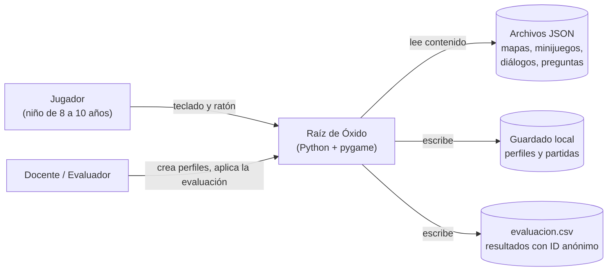

# Especificación de Requerimientos de Software (SRS)
## Raíz de Óxido · Versión 1.1

**Proyecto Integrador:** Introducción a la Ingeniería de Software
Universidad de Colima, FIE · Grupo 1D
Equipo: Ruiz García Osmar y Virgen Cervantes Hugo Alberto
Profesor: Fernando Tomas Diaz Garcia
Plantilla: IEEE 830-1998 adaptada a Markdown

### Control de versiones

| Versión | Fecha | Autores | Cambios |
|---|---|---|---|
| 1.0 | 12/11/2026 | Ruiz García Osmar y Virgen Cervantes Hugo Alberto | Primera versión: secciones 1 a 3, 11 requerimientos funcionales y 6 no funcionales. |
| 1.1 | 24/11/2026 | Ruiz García Osmar y Virgen Cervantes Hugo Alberto | Se integra al repositorio de análisis y diseño; referencias actualizadas a los diagramas UML (`2-uml/`) y al diseño de pantallas (`3-pantallas/`). |

---

## Índice

1. [Introducción](#1-introducción)
   1.1 Propósito · 1.2 Alcance · 1.3 Glosario · 1.4 Referencias · 1.5 Visión general
2. [Descripción general](#2-descripción-general)
   2.1 Perspectiva del producto · 2.2 Funciones del producto · 2.3 Usuarios · 2.4 Restricciones · 2.5 Supuestos y dependencias
3. [Requerimientos específicos](#3-requerimientos-específicos)
   3.1 Formato de ficha y prioridades · 3.2 Interfaces externas · 3.3 Requerimientos funcionales · 3.4 Requerimientos no funcionales · 3.5 Checklist de calidad · 3.6 Trazabilidad con el tablero

---

## 1. Introducción

### 1.1 Propósito

Este documento especifica los requerimientos del videojuego educativo **Raíz de Óxido**, versión 1.0. Describe **qué** debe hacer el sistema y con qué condiciones de calidad, sin entrar en cómo se programa.

Está dirigido a:

- **El equipo de desarrollo**, como guía para programar, probar y repartir el trabajo.
- **El profesor de la materia**, para revisar y evaluar el alcance del proyecto.
- **Los docentes que apliquen el juego**, para saber qué ofrece y cómo se evalúa el aprendizaje.

### 1.2 Alcance

**Raíz de Óxido** es un videojuego en pixel art con vista desde arriba (*top-down*) y exploración tipo *metroidvania*, hecho en Python con pygame, para niños de 8 a 10 años. Enseña temas de medio ambiente de los Objetivos de Desarrollo Sostenible (ODS) de la ONU: 6, 7, 12, 13, 14 y 15, y el 3 en el tema de residuos peligrosos.

El jugador controla a **Proyect_141**, un ser de raíces que devuelve la vida al Valle Verdemar, contaminado por una fábrica. En cada una de las 7 zonas hay un minijuego de un ODS, y lo que el niño gana al resolverlo (una habilidad, una llave o un código) es lo que le abre la siguiente parte del mapa.

**Objetivo del producto:** que los niños aprendan a diferenciar y comprender conceptos ambientales, y medir ese aprendizaje con una evaluación antes y después de jugar.

**El sistema sí incluye:**

- Menú principal con **Modo Historia** y **Modo Minijuegos**.
- Exploración de un mapa con una introducción en cómic y 7 zonas.
- 7 minijuegos educativos con retroalimentación inmediata y sistema de estrellas.
- Enciclopedia coleccionable, guardado automático y perfiles para computadoras compartidas.
- Evaluación de 7 preguntas antes y después del Modo Historia.

**El sistema no incluye:**

- Versión para celular o consola.
- Modo multijugador.
- Conexión a internet, cuentas en línea ni compras.

### 1.3 Glosario de términos

| Término | Definición |
|---|---|
| **SRS / ERS** | Especificación de Requerimientos de Software. Este documento. |
| **RF / RNF** | Requerimiento funcional / requerimiento no funcional. |
| **ODS** | Objetivos de Desarrollo Sostenible de la Agenda 2030 de la ONU. |
| **Top-down** | Vista de cámara desde arriba, como en los juegos clásicos de rol. |
| **Metroidvania** | Género en el que el mapa se va abriendo a medida que el jugador obtiene nuevas habilidades. |
| **Proyect_141 (141)** | Personaje que controla el jugador. No tiene boca y nunca habla. |
| **Valle Verdemar** | Mundo del juego, inspirado en Colima, dividido en 7 zonas. |
| **Modo Historia** | Modo con la aventura completa: cómic, exploración, minijuegos, jefes, final y evaluación. |
| **Modo Minijuegos** | Modo para jugar los 7 minijuegos libremente, sin avanzar en la historia. |
| **Minijuego** | Reto corto ligado a un ODS. Cada uno tiene 3 rondas de dificultad creciente. |
| **Ronda** | Nivel de dificultad de un minijuego (1, 2 o 3). |
| **Estrellas** | Calificación de 1 a 3 que obtiene el jugador en un minijuego según sus errores. |
| **Núcleo de Bioma** | Objeto que 141 carga y planta para devolver la vida a una zona. |
| **Punto Fértil** | Lugar del mapa, marcado con luz verde, donde se planta un Núcleo de Bioma. |
| **Punto de Descanso** | Lugar seguro que aparece al plantar un núcleo. Restaura energía, guarda la partida y es el punto de reaparición. |
| **Niebla de Guerra** | Oscuridad que cubre las zonas no exploradas o no restauradas. |
| **Pilas de energía** | Vida de 141 (3 pilas). Sustituyen a la "muerte" y al "Game Over". |
| **Androide** | Enemigo de la fábrica que patrulla el mapa. Si toca a 141, este pierde una pila. |
| **Habilidad** | Poder de 141. Las de exploración son permanentes; las de combate ocupan uno de 3 *slots*. |
| **Enciclopedia** | Registro coleccionable de especies, objetos, Tarjetas de Memoria y páginas del Diario de Lía. |
| **Perfil de jugador** | Datos de un niño (nombre, estrellas, récords y partida) para que varios usen la misma computadora. |
| **Evaluación pre/post** | Las mismas 7 preguntas que se hacen antes de jugar y al terminar, para medir el aprendizaje. |
| **ID anónimo** | Código que identifica a un jugador en los resultados de la evaluación sin usar su nombre real. |
| **pygame** | Biblioteca de Python para hacer videojuegos en 2D. |
| **FPS** | Cuadros por segundo; mide qué tan fluido se ve el juego. |
| **JSON / CSV** | Formatos de archivo de texto. JSON guarda el contenido del juego; CSV guarda los resultados de la evaluación en forma de tabla. |
| **Escena** | Pantalla del juego (menú, mundo, minijuego...). El *Scene Manager* las administra en una pila. |

### 1.4 Referencias

- Equipo Raíz de Óxido. (2026). *Documento de Diseño del Juego (GDD), versión 4*. Documento interno del proyecto.
- Diagramas UML del proyecto: carpeta [`2-uml/`](../2-uml/) (casos de uso, clases del módulo de Minijuegos y secuencia de un escenario principal).
- Diseño de pantallas: carpeta [`3-pantallas/`](../3-pantallas/).
- Institute of Electrical and Electronics Engineers. (1998). *IEEE recommended practice for software requirements specifications* (IEEE Std 830-1998). https://doi.org/10.1109/IEEESTD.1998.88286
- International Organization for Standardization, International Electrotechnical Commission, & Institute of Electrical and Electronics Engineers. (2018). *Systems and software engineering — Life cycle processes — Requirements engineering* (ISO/IEC/IEEE 29148:2018). https://doi.org/10.1109/IEEESTD.2018.8559686
- Organización de las Naciones Unidas. (2015). *Transformar nuestro mundo: la Agenda 2030 para el Desarrollo Sostenible* (A/RES/70/1). https://www.un.org/es/comun/docs/?symbol=A/RES/70/1

### 1.5 Visión general del documento

- La **sección 2** describe el producto en general: cómo se relaciona con su entorno, sus funciones principales, quiénes lo usan y qué restricciones y supuestos lo condicionan.
- La **sección 3** contiene los requerimientos específicos en formato de ficha, el checklist de calidad que pasó cada uno y su relación con los *Issues* del tablero de GitHub Projects.

---

## 2. Descripción general

### 2.1 Perspectiva del producto

Raíz de Óxido es un programa **independiente**: no forma parte de otro sistema y no necesita internet. Se ejecuta en una computadora de escritorio o portátil y guarda todo en archivos locales.

### 2.2 Funciones del producto

| Función | Descripción breve |
|---|---|
| Menú y modos | Elegir Modo Historia, Modo Minijuegos, Enciclopedia, Opciones o Salir. |
| Exploración | Mover a 141 por el valle, hablar con personajes y esquivar androides. |
| Restauración | Cargar y plantar Núcleos de Bioma para quitar la niebla y revivir las zonas. |
| Minijuegos | Resolver 7 retos educativos, uno por zona y ODS, que entregan la recompensa para avanzar. |
| Aprendizaje | Explicar cada error con una frase corta y mostrar datos curiosos. |
| Colección | Desbloquear entradas de la Enciclopedia. |
| Progreso | Guardar automáticamente y permitir continuar; un perfil por niño. |
| Evaluación | Aplicar 7 preguntas antes y después del Modo Historia y guardar los resultados. |

### 2.3 Características de los usuarios

| Usuario | Descripción | Necesidades |
|---|---|---|
| **Jugador** | Niño o niña de 8 a 10 años (3.° a 5.° de primaria). Lectura básica en español; puede no tener experiencia con videojuegos de computadora. | Poco texto, letra grande, íconos claros, controles simples y nada de "Game Over" ni violencia. |
| **Docente / Evaluador** | Maestro o maestra que aplica el juego en el aula; no necesita conocimientos de programación. | Crear un perfil por niño en una computadora compartida y obtener los resultados de la evaluación en un archivo fácil de abrir (CSV en Excel). |
| **Equipo de desarrollo** | Los dos integrantes del equipo. | Un modo oculto de administrador para probar zonas y minijuegos sin jugar todo el recorrido. |

### 2.4 Restricciones

| ID | Restricción |
|---|---|
| R-01 | Se programa en **Python 3.10 o superior** con **pygame 2**, sin motores de videojuego externos. |
| R-02 | Funciona en **Windows 10/11 y Linux**, con teclado y ratón. |
| R-03 | Funciona **sin conexión a internet**. |
| R-04 | **No recopila datos personales** de los niños: los resultados de la evaluación solo usan un ID anónimo. |
| R-05 | Todo el texto del juego está en **español** y es apropiado para niños: sin violencia gráfica ni lenguaje ofensivo. |
| R-06 | El equipo es de **dos integrantes** y el proyecto debe terminarse dentro del semestre, según el cronograma entregado en la materia. |
| R-07 | El arte es **pixel art**, y los recursos gráficos y de sonido que no sean propios deben tener una licencia que permita usarlos. |

### 2.5 Supuestos y dependencias

| ID | Supuesto o dependencia |
|---|---|
| S-01 | Las computadoras de la escuela tienen al menos un procesador de 4 núcleos, 4 GB de RAM y pantalla de 1280 × 720 píxeles o más. |
| S-02 | Los niños saben leer frases cortas en español; si no, el docente o la opción de lectura en voz alta los apoyan. |
| S-03 | Un docente está presente para crear los perfiles y aplicar la evaluación. |
| S-04 | La escuela y los padres o tutores autorizan la prueba con niños. |
| S-05 | El juego se entrega como ejecutable o con un archivo `Jugar.bat` que instala lo necesario, así que no hace falta saber programar para abrirlo. |
| S-06 | El juego depende de la biblioteca pygame. Si una nueva versión cambia su funcionamiento, se fijará la versión en `requirements.txt`. |

---

## 3. Requerimientos específicos

### 3.1 Formato de ficha y prioridades

Cada requerimiento usa la misma ficha:

| Campo | Contenido |
|---|---|
| **ID** | Identificador único (RF-xx o RNF-xx). Se repite en el título de su *Issue*. |
| **Título** | Nombre corto del requerimiento. |
| **Descripción** | Qué debe hacer el sistema, escrito como "El sistema deberá..." o "Cuando..., el sistema deberá...". |
| **Prioridad** | **Alta:** indispensable para la versión que se probará con niños. **Media:** importante, pero el juego funciona sin ella. **Baja:** deseable si hay tiempo. |
| **Criterio de aceptación** | Prueba concreta en formato *Dado / Cuando / Entonces* para decidir si se cumple. |
| **Origen** | Sección del GDD v4 de donde viene. |
| **Responsable** | Integrante que lo desarrolla. |

### 3.2 Interfaces externas

- **Interfaz de usuario:** ventana de 1280 × 720 píxeles con opción de pantalla completa. Texto en español con letra grande e íconos de apoyo.
- **Hardware:** teclado y ratón. En el mundo se usa teclado (WASD o flechas para moverse, E para interactuar, Espacio, Q y Shift para habilidades, Tab para el mapa y Esc para pausa). Los minijuegos usan solo ratón, excepto *¡Atrápalo, sirve!*, que usa solo las flechas.
- **Software:** sistema operativo Windows 10/11 o Linux con Python 3.10+ y pygame 2.
- **Archivos:** el contenido se lee de archivos JSON; los resultados de la evaluación se escriben en `evaluacion.csv`.

### 3.3 Requerimientos funcionales

#### RF-01 · Menú principal y modos de juego

| Campo | Contenido |
|---|---|
| **Descripción** | Al abrir el juego, el sistema deberá mostrar el menú principal con cinco opciones: Modo Historia (Nueva partida / Continuar), Modo Minijuegos, Enciclopedia, Opciones y Salir. Cada opción se podrá elegir con el ratón o con el teclado. |
| **Prioridad** | Alta |
| **Criterio de aceptación** | **Dado** que el jugador abre el juego, **cuando** termina la pantalla de inicio, **entonces** ve las cinco opciones, y cada una abre su pantalla en menos de 2 segundos al elegirla con clic o con flechas y Enter. "Continuar" aparece desactivado si el perfil no tiene partida guardada. |
| **Origen** | GDD v4, RF-19 |
| **Responsable** | Ruiz García Osmar |

#### RF-02 · Movimiento de Proyect_141

| Campo | Contenido |
|---|---|
| **Descripción** | El sistema deberá mover a 141 en 8 direcciones con WASD o las flechas, a velocidad constante también en diagonal, sin atravesar paredes ni obstáculos, y la cámara lo seguirá centrado en pantalla. |
| **Prioridad** | Alta |
| **Criterio de aceptación** | **Dado** que 141 está en una zona libre, **cuando** el jugador mantiene una o dos teclas de dirección, **entonces** 141 se mueve en esa dirección a la misma velocidad en recto y en diagonal (diferencia menor al 5 %), se detiene al soltar las teclas y no entra en ninguna casilla marcada como pared. |
| **Origen** | GDD v4, RF-01 |
| **Responsable** | Virgen Cervantes Hugo Alberto |

#### RF-03 · Cargar y plantar el Núcleo de Bioma

| Campo | Contenido |
|---|---|
| **Descripción** | Cuando 141 está junto a un Núcleo de Bioma y el jugador presiona E, el sistema deberá ponerlo en estado *Cargando*: su velocidad baja al 60 % y no puede usar habilidades de combate. Cuando deja el núcleo en un Punto Fértil, el sistema deberá restaurar la zona: quitar la Niebla de Guerra, cambiar el suelo industrial por naturaleza, mostrar fauna y personajes y crear un Punto de Descanso. |
| **Prioridad** | Alta |
| **Criterio de aceptación** | **Dado** que 141 carga un núcleo, **entonces** su velocidad medida es el 60 % (± 5 %) de la normal y las teclas de habilidad no hacen nada. **Cuando** presiona E sobre un Punto Fértil, **entonces** en menos de 3 segundos la niebla de esa zona desaparece, cambia el suelo, aparece el Punto de Descanso y la zona queda registrada como restaurada en el guardado. |
| **Origen** | GDD v4, RF-02 y RF-15 |
| **Responsable** | Virgen Cervantes Hugo Alberto |

#### RF-04 · Daño y reaparición sin "Game Over"

| Campo | Contenido |
|---|---|
| **Descripción** | Cuando un androide toca a 141, el sistema deberá quitarle 1 de sus 3 pilas de energía y, si cargaba un núcleo, regresar el núcleo a su posición original. Cuando se queda sin pilas, 141 deberá reaparecer en el último Punto de Descanso visitado con las 3 pilas, sin perder habilidades, estrellas ni entradas de la Enciclopedia. |
| **Prioridad** | Alta |
| **Criterio de aceptación** | **Dado** que 141 tiene 3 pilas y carga un núcleo, **cuando** un androide lo toca, **entonces** el indicador muestra 2 pilas y el núcleo vuelve a su lugar. **Cuando** pierde la última pila, **entonces** aparece en el último Punto de Descanso con 3 pilas, sin pantalla de "Game Over", y su lista de habilidades, estrellas y Enciclopedia es idéntica a la de antes del golpe. |
| **Origen** | GDD v4, RF-17 |
| **Responsable** | Virgen Cervantes Hugo Alberto |

#### RF-05 · Minijuegos educativos con recompensa de progreso

| Campo | Contenido |
|---|---|
| **Descripción** | El sistema deberá ofrecer 7 minijuegos, uno por zona y ligado a un ODS: La Torre de la Vida (ODS 15), ¡Atrápalo, sirve! (ODS 12), Tubería Limpia (ODS 6), Rescate de Tortugas (ODS 14), La Banda Separadora (ODS 12), Detective de Peligros (ODS 3 y 12) y Reconecta la Fábrica (ODS 7 y 13). En el Modo Historia, cuando 141 interactúa con el punto del minijuego, el sistema deberá pausar el mundo, abrir el minijuego y, al ganarlo, regresar al mundo y entregar su recompensa (habilidad, llave o código), que abre un camino nuevo del mapa. |
| **Prioridad** | Alta |
| **Criterio de aceptación** | **Dado** que 141 está en el punto de un minijuego, **cuando** presiona E, **entonces** se abre el minijuego y los androides del mundo dejan de moverse. **Cuando** el jugador gana, **entonces** regresa al mismo lugar del mundo, aparece el mensaje de la recompensa y el paso que antes estaba bloqueado se puede cruzar. Se verifica con cada uno de los 7 minijuegos. |
| **Origen** | GDD v4, RF-03 a RF-10 |
| **Responsable** | Ruiz García Osmar |

#### RF-06 · Retroalimentación educativa ante errores

| Campo | Contenido |
|---|---|
| **Descripción** | Cuando el jugador se equivoca en un minijuego, el sistema deberá mostrar una frase de máximo 12 palabras que explique por qué, junto con un ícono, y volver a presentar el objeto. Tras 3 errores seguidos, deberá resaltar la opción correcta. Cada 3 aciertos seguidos, deberá mostrar un dato "¿Sabías que...?". |
| **Prioridad** | Alta |
| **Criterio de aceptación** | **Dado** un minijuego en curso, **cuando** el jugador comete un error, **entonces** aparece una frase de 12 palabras o menos con la razón y el objeto vuelve a estar disponible. **Cuando** comete 3 errores seguidos, **entonces** la opción correcta se resalta. **Cuando** logra 3 aciertos seguidos, **entonces** aparece un dato "¿Sabías que...?". Además, un script revisa que ningún texto de retroalimentación en los archivos JSON pase de 12 palabras. |
| **Origen** | GDD v4, RF-11 |
| **Responsable** | Ruiz García Osmar |

#### RF-07 · Sistema de estrellas

| Campo | Contenido |
|---|---|
| **Descripción** | Al terminar un minijuego ganado, el sistema deberá otorgar de 1 a 3 estrellas según el número de errores, con los límites definidos en el archivo de datos de cada minijuego. Con 1 estrella se entrega la recompensa; con 3 estrellas se desbloquea una entrada extra de la Enciclopedia. Se guardará siempre la mejor calificación. |
| **Prioridad** | Media |
| **Criterio de aceptación** | **Dado** un minijuego con límites de 0 a 1 errores = 3 estrellas, 2 a 3 errores = 2 estrellas y 4 o más = 1 estrella, **cuando** el jugador gana con 0, 2 y 5 errores, **entonces** obtiene 3, 2 y 1 estrellas. Si repite el minijuego y saca menos estrellas, se conserva la mejor. Con 3 estrellas aparece la nueva entrada en la Enciclopedia. |
| **Origen** | GDD v4, RF-12 |
| **Responsable** | Ruiz García Osmar |

#### RF-08 · Modo Minijuegos

| Campo | Contenido |
|---|---|
| **Descripción** | El sistema deberá permitir jugar cualquiera de los 7 minijuegos desde el inicio, sin haber avanzado en el Modo Historia, eligiendo la ronda 1, 2 o 3. Para cada minijuego mostrará las estrellas y la mejor puntuación del perfil actual. De Reconecta la Fábrica solo se jugará la fase de elegir energías. |
| **Prioridad** | Alta |
| **Criterio de aceptación** | **Dado** un perfil nuevo sin partida de historia, **cuando** entra al Modo Minijuegos, **entonces** las 7 tarjetas están disponibles y cada una deja elegir la ronda 1, 2 o 3. **Cuando** termina una ronda, **entonces** al volver al selector se ven sus estrellas y su mejor puntuación, y esos datos siguen ahí después de cerrar y abrir el juego. |
| **Origen** | GDD v4, RF-20 |
| **Responsable** | Ruiz García Osmar |

#### RF-09 · Enciclopedia

| Campo | Contenido |
|---|---|
| **Descripción** | El sistema deberá registrar las entradas desbloqueadas (especies, objetos de los minijuegos, Tarjetas de Memoria y páginas del Diario de Lía), cada una con dibujo y un dato corto, y permitir consultarlas desde el menú principal y desde los Puntos de Descanso. La Enciclopedia es la misma en ambos modos. |
| **Prioridad** | Media |
| **Criterio de aceptación** | **Dado** que el jugador acierta un objeto en un minijuego por primera vez, **cuando** abre la Enciclopedia, **entonces** esa ficha aparece con su dibujo y su dato, y las fichas no desbloqueadas se ven como silueta. La misma ficha se ve tanto si se desbloqueó en el Modo Historia como en el Modo Minijuegos. |
| **Origen** | GDD v4, RF-13 |
| **Responsable** | Virgen Cervantes Hugo Alberto |

#### RF-10 · Guardado automático, continuar partida y perfiles

| Campo | Contenido |
|---|---|
| **Descripción** | Cuando 141 entra a un Punto de Descanso, el sistema deberá guardar automáticamente las zonas restauradas, habilidades, estrellas y Enciclopedia del perfil actual. "Continuar" deberá cargar esa partida. Además, el sistema deberá permitir crear un "Nuevo jugador" con un nombre, para que varios niños usen la misma computadora sin mezclar su progreso. |
| **Prioridad** | Alta |
| **Criterio de aceptación** | **Dado** que el jugador entra a un Punto de Descanso, **cuando** cierra el juego y lo vuelve a abrir con "Continuar", **entonces** aparece en ese Punto de Descanso con las mismas zonas, habilidades, estrellas y entradas. **Dado** que se crea un segundo jugador, **entonces** este empieza sin progreso y el progreso del primero no cambia. Si el guardado falla (por ejemplo, por falta de permisos), el juego muestra un aviso y no se cierra. |
| **Origen** | GDD v4, RF-18; UML, caso de uso "Crear nuevo jugador" |
| **Responsable** | Virgen Cervantes Hugo Alberto |

#### RF-11 · Evaluación antes y después de jugar

| Campo | Contenido |
|---|---|
| **Descripción** | En el Modo Historia, al iniciar la primera partida de un perfil, el sistema deberá presentar 7 preguntas de opción múltiple con imágenes, una por objetivo de aprendizaje. Al terminar el juego deberá presentar las mismas 7 preguntas. Las respuestas se guardarán en `evaluacion.csv` con el ID anónimo del jugador, el momento (antes o después), la fecha y el número de aciertos. |
| **Prioridad** | Alta |
| **Criterio de aceptación** | **Dado** un perfil nuevo, **cuando** elige "Nueva partida", **entonces** responde las 7 preguntas antes de ver el cómic y en `evaluacion.csv` aparece una fila con su ID anónimo, "pre" y sus aciertos. **Cuando** termina el juego, **entonces** responde las mismas 7 preguntas y aparece una fila "post". El archivo se abre en Excel con una columna por dato y no contiene el nombre del niño. |
| **Origen** | GDD v4, RF-14 |
| **Responsable** | Ruiz García Osmar |

### 3.4 Requerimientos no funcionales

#### RNF-01 · Rendimiento

| Campo | Contenido |
|---|---|
| **Descripción** | En la computadora de referencia (procesador de 4 núcleos, 4 GB de RAM, gráficos integrados, 1280 × 720), el juego deberá mantener un promedio de al menos 55 FPS, y nunca bajar de 45 FPS por más de 1 segundo, durante 5 minutos de juego en la zona con más enemigos. Todas las actualizaciones usarán *delta time* para que la velocidad del juego no dependa de los FPS. |
| **Prioridad** | Alta |
| **Criterio de aceptación** | **Dado** el juego en la computadora de referencia, **cuando** se juega 5 minutos en El Vertedero con el contador de FPS del modo administrador, **entonces** el promedio registrado es de 55 FPS o más y no hay caídas por debajo de 45 FPS que duren más de 1 segundo. |
| **Origen** | GDD v4, RNF-02 y RNF-07 |

#### RNF-02 · Usabilidad para niños de 8 a 10 años

| Campo | Contenido |
|---|---|
| **Descripción** | Todos los mensajes al jugador tendrán como máximo 12 palabras. El texto se mostrará con un tamaño de letra de al menos 24 píxeles a 1280 × 720. Cada instrucción de minijuego irá acompañada de un ícono. Ningún minijuego mezclará teclado y ratón. |
| **Prioridad** | Alta |
| **Criterio de aceptación** | **Dado** el contenido del juego, **cuando** se ejecuta el script de revisión de textos, **entonces** ningún mensaje de minijuego pasa de 12 palabras. **Cuando** se revisa cada pantalla, **entonces** el texto mide 24 px o más y cada minijuego responde a un solo dispositivo. En la prueba con niños, al menos 8 de cada 10 completan el primer minijuego sin ayuda de un adulto. |
| **Origen** | GDD v4, RNF-04 |

#### RNF-03 · Plataforma y entorno

| Campo | Contenido |
|---|---|
| **Descripción** | El juego deberá funcionar en Windows 10/11 y en Linux, con Python 3.10 o superior y pygame 2, sin motores externos y sin conexión a internet. |
| **Prioridad** | Alta |
| **Criterio de aceptación** | **Dado** un equipo con Windows 11 y otro con Linux, ambos sin internet, **cuando** se abre el juego con `Jugar.bat` o `python main.py`, **entonces** llega al menú principal y se puede jugar el primer minijuego en los dos equipos. |
| **Origen** | GDD v4, RNF-03 |

#### RNF-04 · Contenido separado del código

| Campo | Contenido |
|---|---|
| **Descripción** | Los textos, objetos y rondas de los minijuegos, las entradas de la Enciclopedia, los diálogos y las preguntas de la evaluación deberán guardarse en archivos JSON, de modo que se puedan cambiar sin modificar el código Python. |
| **Prioridad** | Media |
| **Criterio de aceptación** | **Dado** el archivo JSON de un minijuego, **cuando** se cambia el texto de una pista o se agrega un objeto y se reinicia el juego, **entonces** el cambio aparece en pantalla sin haber editado ningún archivo `.py`. |
| **Origen** | GDD v4, RNF-06 |

#### RNF-05 · Privacidad de los niños

| Campo | Contenido |
|---|---|
| **Descripción** | El juego no deberá pedir ni guardar datos personales del niño fuera de un nombre o apodo para su perfil. Los resultados de la evaluación solo usarán el ID anónimo, y el juego no enviará ningún dato por red. |
| **Prioridad** | Alta |
| **Criterio de aceptación** | **Dado** que se juega una partida completa con evaluación, **cuando** se revisa `evaluacion.csv`, **entonces** no contiene nombres, solo el ID anónimo. **Cuando** se revisa el código, **entonces** no usa ninguna biblioteca de red y el juego funciona con la red desactivada. |
| **Origen** | Restricción R-04 de este SRS |

#### RNF-06 · Duración de los minijuegos

| Campo | Contenido |
|---|---|
| **Descripción** | Cada ronda de minijuego deberá poder completarse en un tiempo de entre 2 y 4 minutos para un niño de 8 a 10 años. |
| **Prioridad** | Media |
| **Criterio de aceptación** | **Dado** un grupo de prueba de al menos 5 niños de 8 a 10 años, **cuando** juegan la ronda 1 de cada minijuego, **entonces** el tiempo promedio de cada minijuego, medido por el propio juego, está entre 2 y 4 minutos. |
| **Origen** | GDD v4, RNF-05 |

### 3.5 Checklist de calidad

Cada requerimiento se revisó contra los seis criterios de la actividad, basados en IEEE 830 e ISO/IEC/IEEE 29148.

| Criterio | Pregunta que nos hicimos |
|---|---|
| **Correcto** | ¿Coincide con lo que decidimos en el GDD v4 y con el objetivo educativo? |
| **No ambiguo** | ¿Tiene una sola interpretación? ¿Quitamos palabras como "rápido", "fácil" o "a veces"? |
| **Completo** | ¿Dice qué lo dispara, qué hace el sistema y qué resultado se espera? |
| **Consistente** | ¿No contradice a otro requerimiento ni a las restricciones? |
| **Factible** | ¿Se puede hacer con Python y pygame, con dos personas, en el semestre? (Varias funciones ya existen en el prototipo.) |
| **Verificable** | ¿Su criterio de aceptación se puede probar y da un sí o un no? |

| ID | Correcto | No ambiguo | Completo | Consistente | Factible | Verificable |
|---|:---:|:---:|:---:|:---:|:---:|:---:|
| RF-01 | ✅ | ✅ | ✅ | ✅ | ✅ | ✅ |
| RF-02 | ✅ | ✅ | ✅ | ✅ | ✅ | ✅ |
| RF-03 | ✅ | ✅ | ✅ | ✅ | ✅ | ✅ |
| RF-04 | ✅ | ✅ | ✅ | ✅ | ✅ | ✅ |
| RF-05 | ✅ | ✅ | ✅ | ✅ | ✅ | ✅ |
| RF-06 | ✅ | ✅ | ✅ | ✅ | ✅ | ✅ |
| RF-07 | ✅ | ✅ | ✅ | ✅ | ✅ | ✅ |
| RF-08 | ✅ | ✅ | ✅ | ✅ | ✅ | ✅ |
| RF-09 | ✅ | ✅ | ✅ | ✅ | ✅ | ✅ |
| RF-10 | ✅ | ✅ | ✅ | ✅ | ✅ | ✅ |
| RF-11 | ✅ | ✅ | ✅ | ✅ | ✅ | ✅ |
| RNF-01 | ✅ | ✅ | ✅ | ✅ | ✅ | ✅ |
| RNF-02 | ✅ | ✅ | ✅ | ✅ | ✅ | ✅ |
| RNF-03 | ✅ | ✅ | ✅ | ✅ | ✅ | ✅ |
| RNF-04 | ✅ | ✅ | ✅ | ✅ | ✅ | ✅ |
| RNF-05 | ✅ | ✅ | ✅ | ✅ | ✅ | ✅ |
| RNF-06 | ✅ | ✅ | ✅ | ✅ | ✅ | ✅ |

**Correcciones que hicimos al pasar el checklist:**

- En el GDD v4, el rendimiento decía "60 FPS en una computadora escolar promedio". No era verificable, así que en RNF-01 definimos la computadora de referencia, el tiempo de prueba y la zona.
- "Letra grande y legible" era ambiguo; en RNF-02 se fijó en 24 píxeles como mínimo.
- El movimiento, la carga del núcleo y la restauración de la zona estaban repartidos en varios requerimientos del GDD con nombres técnicos; aquí se agruparon por lo que ve el jugador y se agregaron cifras (velocidad al 60 % ± 5 %, restauración en menos de 3 segundos).
- En RF-07 los límites de estrellas por minijuego se dejan en los archivos de datos, y el criterio de aceptación usa un ejemplo con números concretos.
- El "Viaje por las Raíces" entre Puntos de Descanso (GDD v4, RF-23) quedó fuera de la versión 1.0 porque todavía no está aprobado por el equipo.

### 3.6 Trazabilidad con el tablero

Cada requerimiento funcional se convirtió en un *Issue* de GitHub con su ID en el título en el repositorio del curso [UserOsm0605/raiz-de-oxido](https://github.com/UserOsm0605/raiz-de-oxido/issues) y se agregó al tablero [GitHub Projects](https://github.com/users/UserOsm0605/projects/1) en la columna *Backlog*.

| ID | Issue | Responsable | Prioridad |
|---|---|---|---|
| RF-01 | RF-01 · Menú principal y modos de juego | Ruiz García Osmar | Alta |
| RF-02 | RF-02 · Movimiento de Proyect_141 | Virgen Cervantes Hugo Alberto | Alta |
| RF-03 | RF-03 · Cargar y plantar el Núcleo de Bioma | Virgen Cervantes Hugo Alberto | Alta |
| RF-04 | RF-04 · Daño y reaparición sin "Game Over" | Virgen Cervantes Hugo Alberto | Alta |
| RF-05 | RF-05 · Minijuegos educativos con recompensa de progreso | Ruiz García Osmar | Alta |
| RF-06 | RF-06 · Retroalimentación educativa ante errores | Ruiz García Osmar | Alta |
| RF-07 | RF-07 · Sistema de estrellas | Ruiz García Osmar | Media |
| RF-08 | RF-08 · Modo Minijuegos | Ruiz García Osmar | Alta |
| RF-09 | RF-09 · Enciclopedia | Virgen Cervantes Hugo Alberto | Media |
| RF-10 | RF-10 · Guardado automático, continuar partida y perfiles | Virgen Cervantes Hugo Alberto | Alta |
| RF-11 | RF-11 · Evaluación antes y después de jugar | Ruiz García Osmar | Alta |
