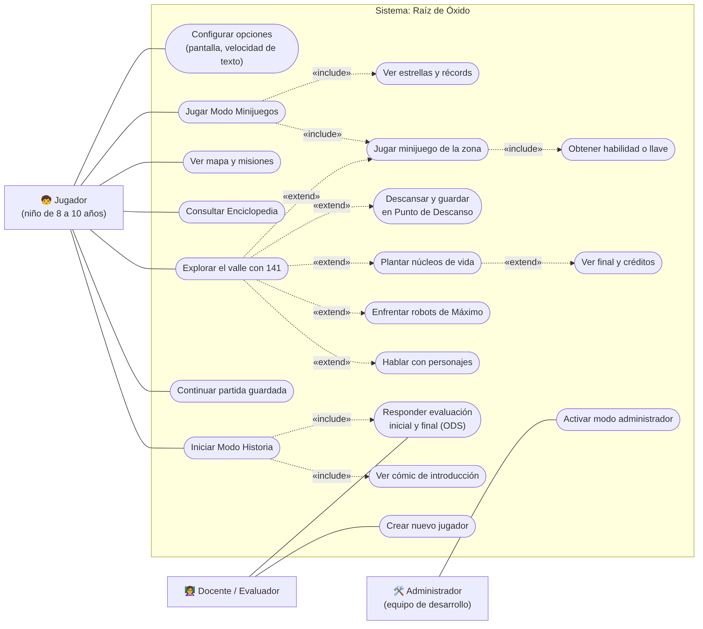
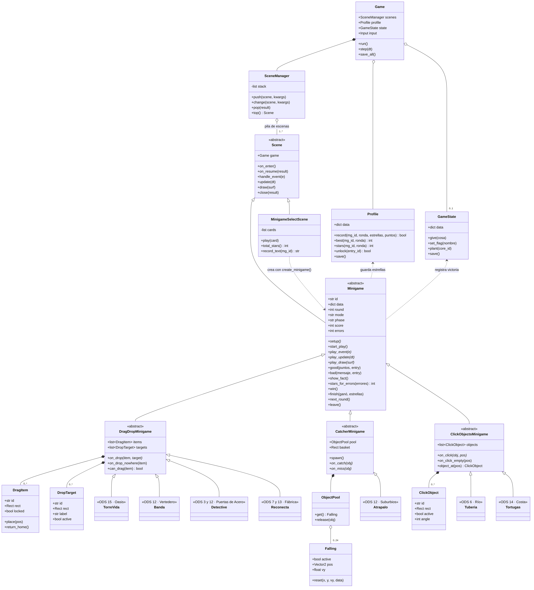
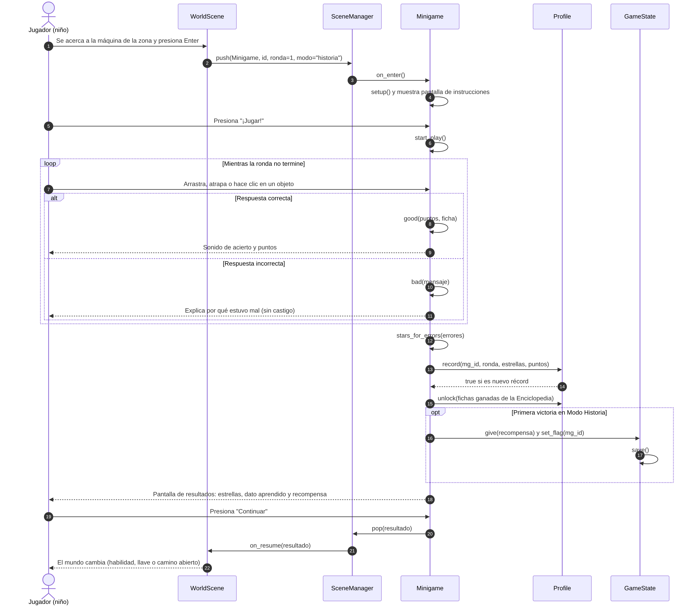

# Diseño UML

Los tres diagramas se hicieron en **Mermaid**. Cada carpeta tiene el código fuente (`.mmd`) y la imagen exportada (`.png`).

| Diagrama | Carpeta | Qué muestra |
|---|---|---|
| Casos de uso | [`casos-de-uso/`](casos-de-uso/) | Quién usa el juego (jugador, docente, administrador) y qué puede hacer con él. |
| Clases | [`clases/`](clases/) | Las clases del módulo de Minijuegos: la clase base `Minigame`, sus tres bases (arrastrar y soltar, atrapar, hacer clic) y los siete minijuegos. |
| Secuencia | [`secuencia/`](secuencia/) | Escenario principal: el jugador entra a un minijuego desde el mundo, juega, recibe estrellas y su recompensa, y vuelve al mapa. |

## 1. Diagrama de casos de uso

El **Jugador** inicia el Modo Historia (que incluye el cómic de introducción y la evaluación inicial), explora el valle, juega los minijuegos, consulta la Enciclopedia y cambia las opciones. El **Docente** crea un jugador nuevo en una computadora compartida y aplica la evaluación. El **Administrador** (equipo de desarrollo) activa el modo de pruebas.

## 2. Diagrama de clases del módulo de Minijuegos

`Minigame` define el ciclo común de todos los minijuegos: instrucciones, juego, aciertos y errores, estrellas y pantalla final. Tres clases abstractas resuelven las mecánicas que se repiten (`DragDropMinigame`, `CatcherMinigame` y `ClickObjectsMinigame`) y cada minijuego concreto solo implementa sus reglas. `Profile` guarda los récords y las fichas de la Enciclopedia, y `GameState` guarda el avance del Modo Historia.

## 3. Diagrama de secuencia: jugar un minijuego en Modo Historia

Muestra el escenario principal del juego. Un error nunca castiga al niño: el minijuego explica por qué estuvo mal y deja seguir. Al terminar se calculan las estrellas, se guarda el récord y, si es la primera victoria, se entrega la recompensa que abre el camino en el mundo.
