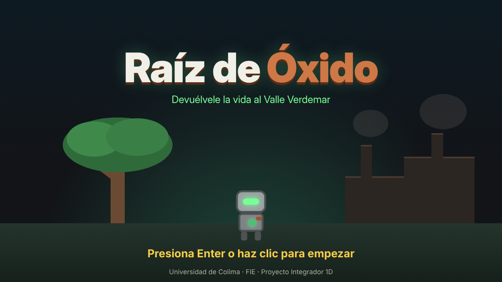
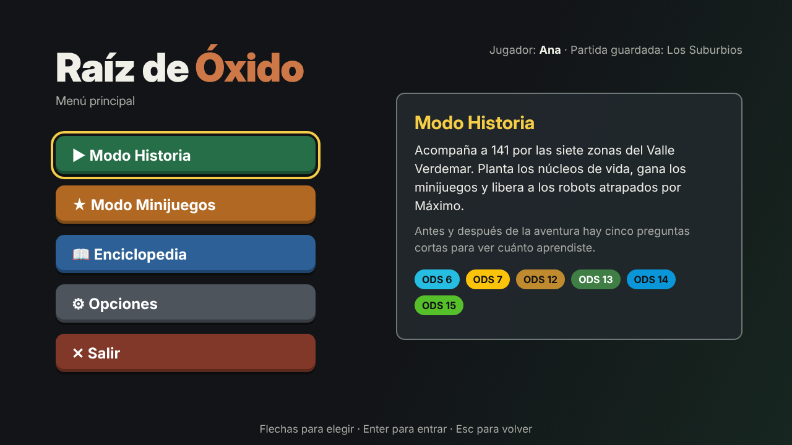
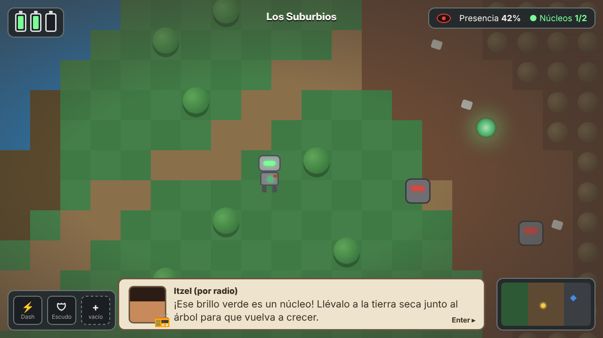
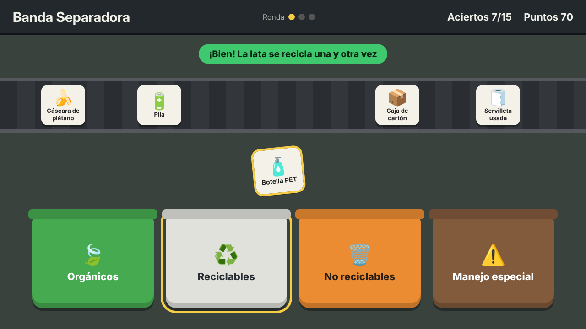
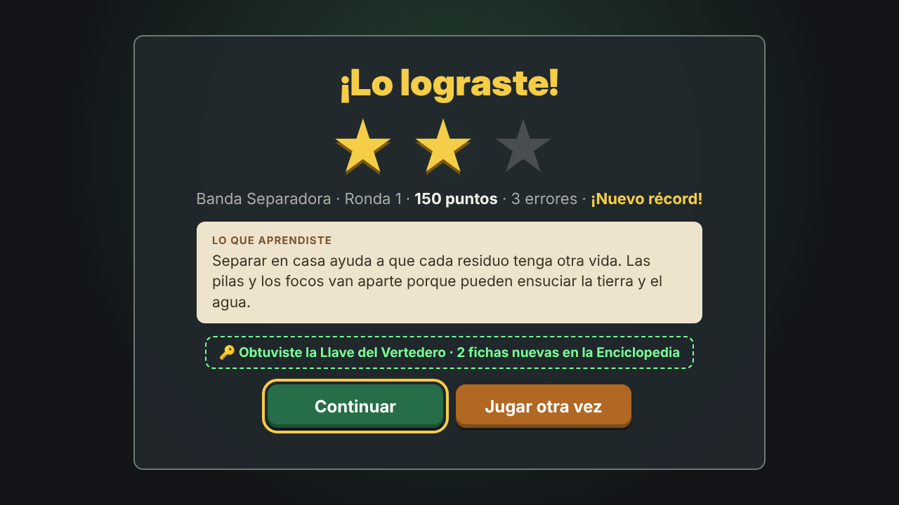
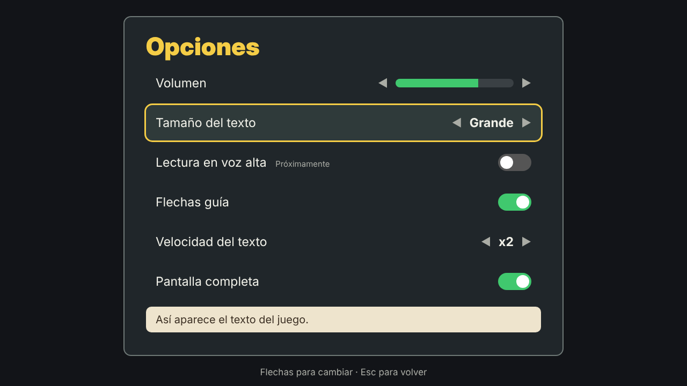
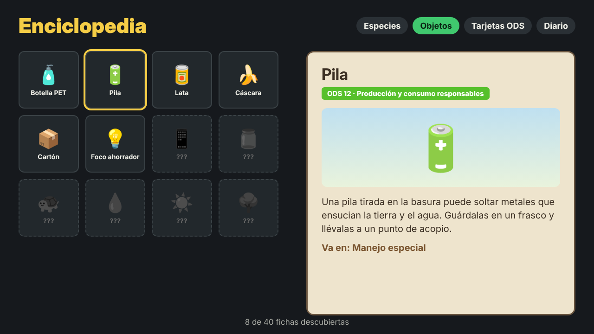

# Diseño de pantallas

**Herramienta:** prototipo en HTML y CSS, exportado a PNG (1280 × 720).  
**Enlace al diseño:** [prototipo navegable](https://userosm0605.github.io/raiz-de-oxido-analisis-diseno-/3-pantallas/prototipo/) · código en [`prototipo/index.html`](prototipo/index.html)

Criterios de diseño para niños de 8 a 10 años: botones grandes con texto e ícono, letra de 24 px como mínimo, una sola acción enfocada a la vez (borde amarillo), control con teclado o ratón, y colores que separan lo natural (verde) de lo contaminado (óxido y gris).

| # | Pantalla | Archivo | Descripción |
|---|---|---|---|
| 1 | Inicio | [01-inicio.png](01-inicio.png) | Título del juego, la Ceiba y la fábrica de Máximo; pide una tecla para empezar. |
| 2 | Menú principal | [02-menu-principal.png](02-menu-principal.png) | Modo Historia, Modo Minijuegos, Enciclopedia, Opciones y Salir. A la derecha se explica la opción enfocada. |
| 3 | Juego (exploración) | [03-juego-exploracion.png](03-juego-exploracion.png) | Vista desde arriba del mundo con el HUD: pilas de energía, Presencia de Máximo, núcleos, habilidades, minimapa y la radio de Itzel. |
| 4 | Minijuego | [04-minijuego.png](04-minijuego.png) | Ejemplo: *Banda Separadora* (ODS 12). Se arrastra cada residuo al bote correcto. |
| 5 | Resultados | [05-resultados.png](05-resultados.png) | Estrellas según los errores, puntos, lo que se aprendió y la recompensa obtenida. |
| 6 | Configuración | [06-configuracion.png](06-configuracion.png) | Volumen, tamaño y velocidad del texto, flechas guía y pantalla completa. |
| 7 | Enciclopedia | [07-enciclopedia.png](07-enciclopedia.png) | Fichas desbloqueadas con datos reales y el ODS relacionado. |

