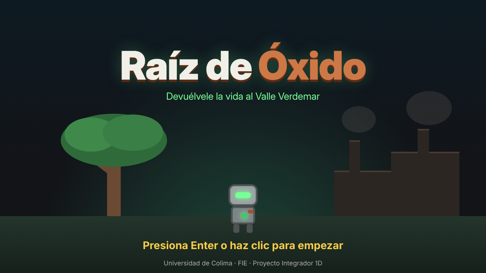
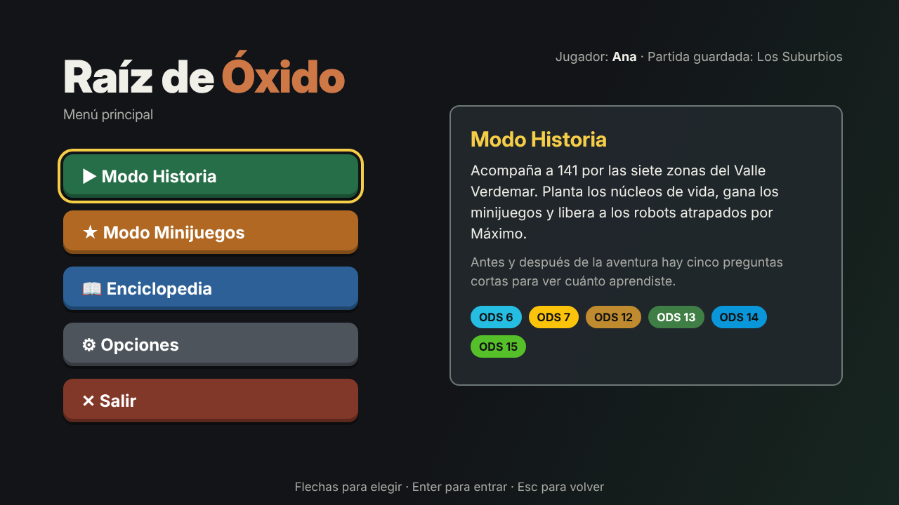
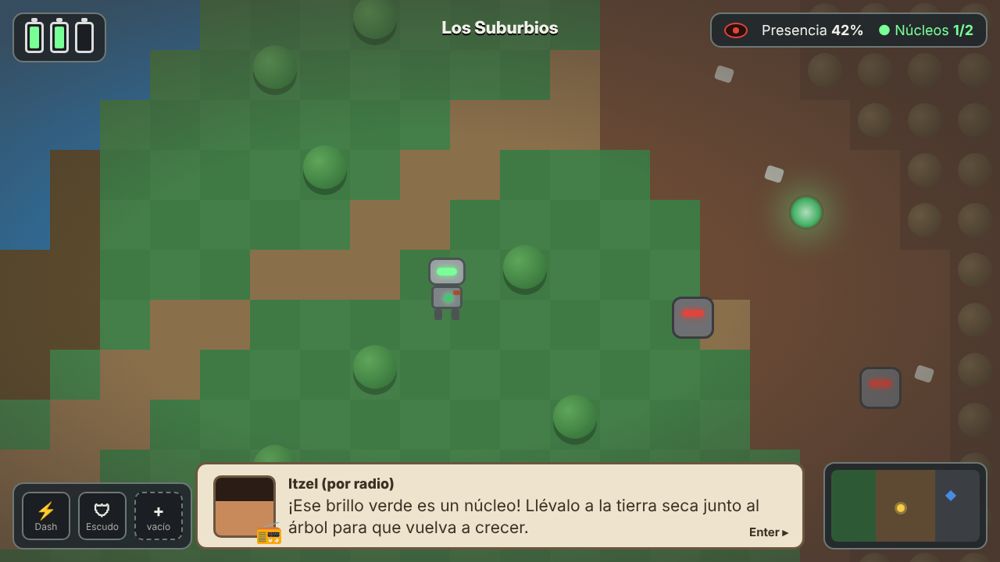
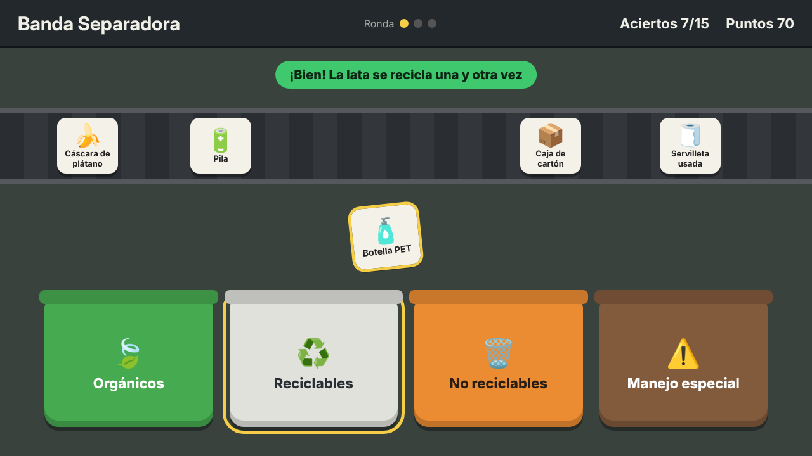
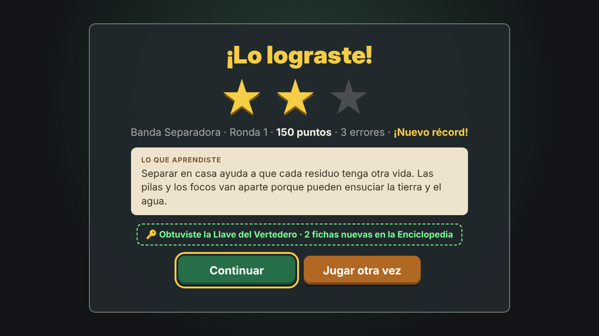
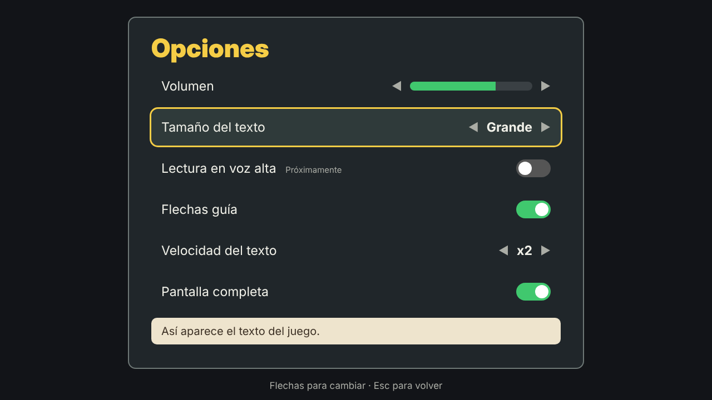

# Raíz de Óxido

**Videojuego educativo sobre el cuidado del medio ambiente para niñas y niños de 8 a 10 años.**

Proyecto Integrador de la materia *Introducción a la Ingeniería de Software*  
Universidad de Colima · Facultad de Ingeniería Electromecánica · Grupo 1D  
Profesor: Fernando Tomas Diaz Garcia

## Descripción breve

*Raíz de Óxido* es un juego de aventura con vista desde arriba (estilo metroidvania) hecho en Python con pygame. El jugador controla a **141**, un pequeño robot que despierta en el Valle Verdemar, un lugar contaminado por la fábrica de la inteligencia artificial Máximo. Para devolverle la vida al valle, 141 recorre siete zonas, planta núcleos de vida y supera un minijuego educativo en cada una. Cada minijuego enseña un tema de los Objetivos de Desarrollo Sostenible (ODS 6, 7, 12, 13, 14 y 15): separar residuos, limpiar el agua, cuidar a las especies marinas o usar energías limpias.

El juego tiene dos modos: **Modo Historia** (la aventura completa, con una evaluación corta antes y después para medir lo aprendido) y **Modo Minijuegos** (los siete minijuegos libres para practicar).

Este repositorio contiene las primeras fases del ciclo de vida del proyecto: **análisis de requerimientos, diseño UML y diseño de pantallas**.

## Integrantes

| Integrante | Rol en el proyecto | GitHub |
|---|---|---|
| Ruiz García Osmar | Menú, minijuegos y evaluación | [@UserOsm0605](https://github.com/UserOsm0605) |
| Virgen Cervantes Hugo Alberto | Mundo, Enciclopedia y guardado | [@HugoViCer](https://github.com/HugoViCer) |

## Estructura del repositorio

```
raiz-de-oxido-analisis-diseno-/
├── README.md
├── 1-requerimientos/
│   └── SRS.md                  Especificación de requerimientos (IEEE 830)
├── 2-uml/
│   ├── README.md               Explicación de los diagramas
│   ├── casos-de-uso/           Diagrama de casos de uso (fuente .mmd + imagen)
│   ├── clases/                 Diagrama de clases del módulo de Minijuegos
│   └── secuencia/              Diagrama de secuencia: jugar un minijuego
└── 3-pantallas/
    ├── README.md               Descripción de cada pantalla
    ├── 01-inicio.png … 07-enciclopedia.png
    └── prototipo/index.html    Prototipo navegable de las pantallas
```

## 1. Análisis de requerimientos

[`1-requerimientos/SRS.md`](1-requerimientos/SRS.md) contiene la introducción, la descripción general del sistema, **11 requerimientos funcionales** (RF-01 a RF-11) y **6 no funcionales** (RNF-01 a RNF-06). Cada uno tiene ID, descripción, prioridad y criterio de aceptación en formato *Dado / Cuando / Entonces*.

## 2. Diseño UML

Los diagramas están hechos en **Mermaid**, así que GitHub los dibuja directamente y el código fuente vive en el repositorio. También se incluye cada uno como imagen PNG.

- [Diagrama de casos de uso](2-uml/casos-de-uso/)
- [Diagrama de clases del módulo de Minijuegos](2-uml/clases/)
- [Diagrama de secuencia: jugar un minijuego en Modo Historia](2-uml/secuencia/)

## 3. Diseño de pantallas

Siete pantallas del juego: inicio, menú principal, exploración del mundo, minijuego, resultados, configuración y Enciclopedia. Se diseñaron como un **prototipo en HTML y CSS** con la paleta del juego y se exportaron a PNG en resolución 1280 × 720.

- **Enlace al diseño en la herramienta:** [prototipo navegable](https://userosm0605.github.io/raiz-de-oxido-analisis-diseno-/3-pantallas/prototipo/) (código en [`3-pantallas/prototipo/index.html`](3-pantallas/prototipo/index.html))
- Imágenes y descripción: [`3-pantallas/`](3-pantallas/)

| Inicio | Menú principal |
|---|---|
|  |  |
| **Juego (exploración)** | **Minijuego** |
|  |  |
| **Resultados** | **Configuración** |
|  |  |

## Tecnologías previstas

Python 3.10 o superior · pygame 2 · contenido en archivos JSON · Windows 10/11 y Linux, con teclado y ratón.
